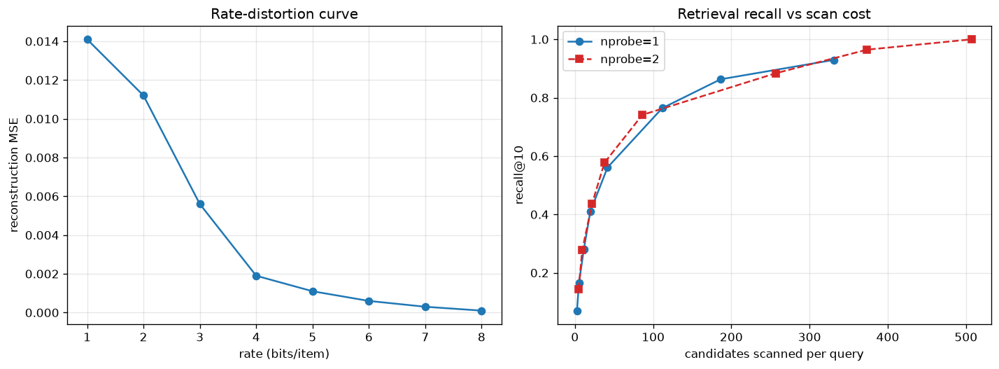
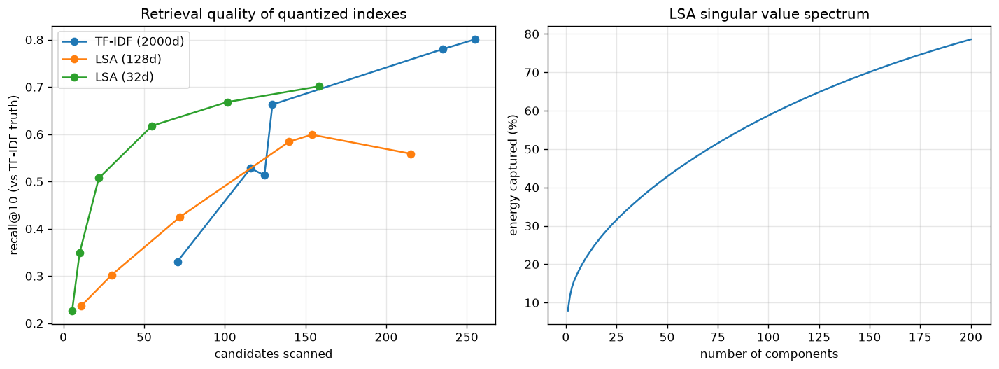

# 实测数据

测试语料:一份个人对话档案,507 条消息,约 33 万字符。

## 索引压缩:率失真

把消息的谱表示(8 维)用 k-means 量化成 K 个码字,码率 = log2 K 比特/条:

| 码率(比特/条) | 1 | 2 | 3 | 4 | 5 | 6 | 7 | 8 |
|---|---|---|---|---|---|---|---|---|
| 重构 MSE | .0141 | .0109 | .0055 | .0019 | .0011 | .0006 | .0003 | .0001 |

## 检索:召回 vs 扫描代价

真值 = 原始 TF-IDF 空间的 10 近邻;"扫描候选数"= 命中簇的成员数。

| 表示 | 码本 K | 每条扫候选数 | 召回@10 |
|---|---|---|---|
| TF-IDF(2000 维) | 16 | 144.3 | 0.674 |
| LSA(32 维) | 16 | 42.1 | 0.580 |
| LSA(128 维) | 16 | 259.9 | 0.729 |

同样召回水平,LSA-32 的扫描代价约为 TF-IDF 的 1/3。

## 内容去重的收益

预算 8000 字符,平铺选 vs 内容级去重:

| 方式 | 返回字符 | 内容簇覆盖率 |
|---|---|---|
| 平铺 top-k | 7839 | 0.49 |
| 内容去重 | 7494 | **0.68** |

## 抑制强度随拥挤度自适应

| 查询 | 强命中 | 拥挤度 | 抑制系数 |
|---|---|---|---|
| 测地线 | 4 | 0.8 | 0.44(放宽) |
| 半正定 | 9 | 2.0 | 1.10 |
| 归一化 | 16 | 2.9 | 1.59 |
| 函数 | 82 | 7.6 | 2.20(顶格) |

## 判定(solid / weak / 拒答)

| 查询 | 判定 | 最高分 | 强命中 |
|---|---|---|---|
| 对偶 | solid | 0.783 | 2 |
| 核函数 | solid | 0.345 | 6 |
| 流形 | weak | 0.206 | 9 |
| 函数 | 拒答(太宽泛) | — | — |
| 量子色动力学 | 拒答(全新话题) | — | — |

## 评测集基线

`python -m eval.eval_set`(10 条固定查询,gold = 含关键词的消息):

| 指标 | 值 |
|---|---|
| mean P@5 | 0.94 |
| mean R@5 | 0.92 |
